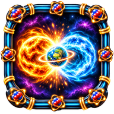

<p align="center"></p>

<h1 align="center">Letopis - Genesis</h1>

<p align="center"><i>Combine elements and rebuild the universe: from the Big Bang to stars, planets, life and human inventions.</i></p>

Letopis - Genesis is a self-hosted educational puzzle game. You start with four things: energy, space, time and matter.
Put two of them together and see what happens. Every discovery comes with a short "did you know" fact, so kids
(and grown-ups) learn how the universe was built while they play.

## Features

- Chapter 1, **Cosmos**: from the Big Bang to stars, black holes, galaxies, planets and the Earth.
- Chapter 2, **Earth**: from water, fire and stone to the first cell, plants, dinosaurs and the first human.
- A short fact for every element, in Bulgarian, English and German, switchable at any time.
- Hints that never give the answer away: a riddle first, then one ingredient, then the shape of the other.
  After the last hint you may skip the element, but it brings no points.
- Points by difficulty, bonuses for streaks without hints and for finished chapters, and titles from Stardust to Creator.
- Player profiles with a 4-digit PIN. Every player can start a new game at any time.
- Progress is saved on your server, so you can stop any time and go on from any device.
- A living space background: every discovery lights a new star in your own constellation.
- Tap or drag & drop. Works on phones, tablets and desktops.

## Running it

```sh
docker run -d --name letopis-genesis -p 2230:2230 -v /path/to/appdata:/data ghcr.io/leppermesiah/letopis-genesis:latest
```

Then open `http://<server>:2230/`.

| Variable | Default | What it does |
|---|---|---|
| `GENESIS_PORT` | `2230` | Port inside the container |
| `GENESIS_DATA` | `/data` | Where the database lives |
| `GENESIS_UNLOCK_PERCENT` | `100` | How much of a chapter must be found before the next one opens |
| `GENESIS_ADMIN_PIN` | empty | Turns on the "Manage" link on the start screen: change a player's PIN or delete a profile |

## Building

```sh
npm ci
npm run check   # the content: every element reachable, every text in all three languages
npm run build
npm start
```

## License

[PolyForm Noncommercial 1.0.0](LICENSE.md): free to use, run, change and share for any noncommercial purpose.
Selling it or using it commercially needs the author's permission.
Third-party material is listed in [CREDITS.md](CREDITS.md).
